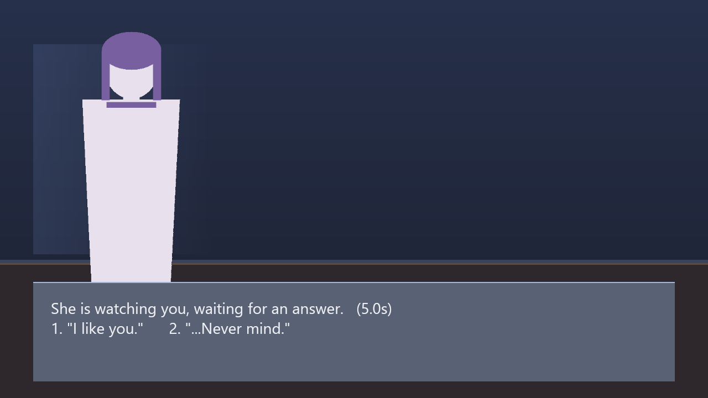
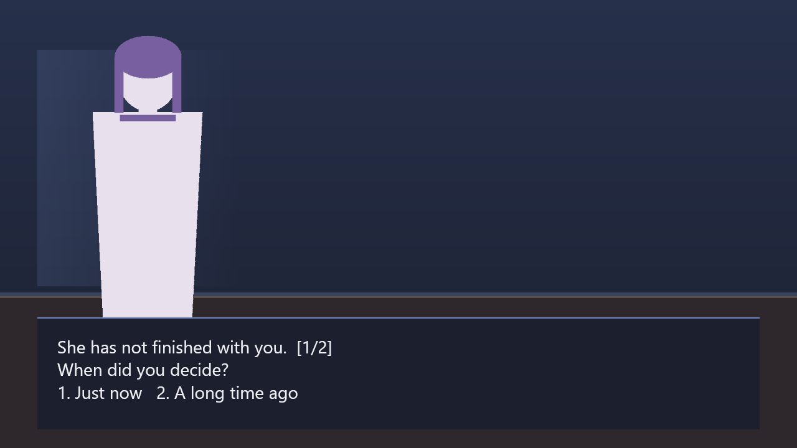

# RuStory

**A Rust-native visual novel engine with composable gameplay.**

RuStory is a visual novel engine built around one idea: the narrative is the
warp, gameplay is the weft. Adding a new gameplay system should mean weaving in
another thread — not tearing the cloth open and patching it back together.

> Not an official Rust project. Not affiliated with or endorsed by the Rust
> Foundation. The name contains "Rust" for the language it is written in.


---

## The claim, and how it is tested

The whole design rests on one falsifiable statement:

> Adding a gameplay system does not change the narrative core.

Two systems ship as evidence, chosen to bracket the range of the contract:

- `crates/rustory-gameplay-timer` — a countdown over a list of options.
- `crates/rustory-gameplay-quiz` — several rounds, a growing list of answers, and
  a verdict that only exists at the end.

`rustory-core` mentions neither. It has no notion of timers, options, rounds,
scores or correctness. Each crate parses its own config from an opaque value,
reports outcome keys, and lets the *script* decide where those keys lead. Each
persists its own state into a save through the same trait.

The entire integration is two lines:

```rust
registry.register(Box::new(TimedChoice::new()));
registry.register(Box::new(Quiz::new()));
```

The quiz is the stronger half of the argument. A countdown can almost be rebuilt
from a few shared counters, so a critic could say the contract only accommodates
simple things. A quiz cannot: it needs a cursor and a list, which is why it also
proves that a save can carry state the core has never heard of.

If adding a system ever requires editing `rustory-core`, the contract is wrong
and the contract gets fixed — not the core.

## Status

**Playable vertical slice.** Working today:

- Load a story from RON, with reference checking before the first frame
- Background, sprites and typewriter dialogue
- Click to advance; first click completes the line, second advances
- Branching choices
- Gameplay handover, with **two** systems: a timed choice and a multi-round quiz
- **Save and load**, including gameplay state mid-system (`F5` / `F9` in a window)
- `rustory play` in a window, or `rustory shot` to render a frame headlessly
- 206 tests, including offscreen GPU renders, colour round-trips, and 45 covering the editor operations

Not yet: audio, rollback history, WASM plugins, an authoring tool. Those have ADRs
describing the plan, not code pretending to be one.

## Editor

Two front-ends, one operation layer. The GUI and the CLI both construct
`rustory_edit::EditOp` values and hand them to the same executor, so an agent can do
anything a person can — not by keeping two programs in agreement, but because there is
only one program's worth of rules.


```console
$ cargo run -p rustory-editor                        # new story
$ cargo run -p rustory-editor -- stories/demo.ron    # open an existing one
$ cargo run -p rustory -- ops --json                 # what an agent can do
$ cargo run -p rustory -- inspect stories/demo.ron --json
$ cargo run -p rustory -- edit stories/demo.ron --op '{"op":"CreateNode","id":"epilogue"}'
```

`ops` prints a JSON body for each operation that parses as written — copy one and change
its values, rather than inferring field names from prose. `--json` output is a single
document on stdout; anything else goes to stderr, so a parser can trust it.

The editor is a normal desktop application: **New / Open / Save / Save as** with
`Ctrl+N`, `Ctrl+O`, `Ctrl+S`, `Ctrl+Shift+S`, undo and redo on `Ctrl+Z` / `Ctrl+Y`, and a
prompt before anything throws away unsaved work. **Recent** keeps the last ten stories one
click away, and the same list is readable from a terminal — an agent can ask what the user
has been editing without opening a window:

```console
$ cargo run -p rustory-editor -- --recent          # one path per line
$ cargo run -p rustory-editor -- --recent --json   # same list, structured
```

The list lives in `%APPDATA%\rustory\recent.json` (`$XDG_CONFIG_HOME/rustory` elsewhere)
and is pruned on startup: an entry that no longer opens is dropped rather than offered.


Nodes, beats, exits, choices and gameplay outcome mappings are all editable as forms.
The outcome table is what makes a gameplay system reusable: the same `timer.timed_choice`
can mean different things in different scenes because *where each key leads is data*.

The node list has a filter, and every reference — a `goto`, a choice target, a gameplay
outcome — has a **Go** button beside it, so following a branch never means remembering a
node name and scrolling to find it. The node being edited also lists who points at it —
the same list that would block a delete, computed by the same function — with a click to
jump to each referrer. Selection is UI state, not an edit: it takes no undo step and is
never written to disk.


Every edit is **all or nothing**: `Editor::apply` either succeeds and leaves a valid
document, or fails and leaves it byte-for-byte as it was. That is what makes the CLI
safe to point an agent at.

Deleting a node that is still referenced is refused, and the error names every
referrer. Deleting the last choice of a branch is refused rather than silently
turning the exit into an `End`.

Content problems that are not errors are reported instead: a node no path can reach, a
gameplay node that maps no outcomes. They are listed in the preview panel and in the
status bar, not refused, because a draft branch is a normal state while writing.

The preview panel is the real engine — `rustory_render` drawing the same `Frame` that
`rustory play` shows — and it starts at the node you have selected, so clicking a node
shows that node's frame rather than the top of the story. It is a playthrough, not a
still: click the picture to advance, and when the story offers branches they appear as
buttons under it. See [ADR 0008](docs/adr/0008-editor-architecture.md).

## Try it

```console
$ cargo run -p rustory -- gen-assets assets       # placeholder art
$ cargo run -p rustory -- check stories/demo.ron  # parse + validate (--json for a report)
$ cargo run -p rustory -- play stories/demo.ron   # play it
$ cargo run -p rustory -- shot stories/demo.ron --out frame.png --advance 4
$ cargo run -p rustory -- shot stories/demo.ron --at honest:2 --out frame.png

$ cargo run -p rustory -- save stories/demo.ron --advance 6 --out save.ron
$ cargo run -p rustory -- resume stories/demo.ron save.ron --finish
```

`--advance` counts clicks, which is what a player does; `--at` names a position, which
is what a caller who knows what it wants does. They are not the same thing: one click can
finish a revealing line without moving on, and inside a gameplay system a click plays the
whole interaction.

The demo runs without a window too:

```console
$ cargo run -p rustory -- transcript stories/demo.ron
After school, the classroom holds only two people.
Yuki: You haven't left yet?
Kai: I was waiting for you.
...
```

## Screens

| Dialogue | Choice | Timed choice | Quiz |
|---|---|---|---|
|  |  |  |  |

The art is generated procedurally by `rustory gen-assets` — no binaries in the
repository, and the code that draws it is reviewable.

## Architecture

The engine is written directly against the platform, without a third-party game
engine underneath. **Game semantics are ours; operating-system abstractions are
borrowed.**

| Layer | Crate | Owns |
|---|---|---|
| Narrative core | `rustory-core` | Story model, state machine, gameplay contract. Zero rendering dependencies |
| Story format | `rustory-script` | RON loading, reference validation |
| Renderer | `rustory-render` | Draw list → pixels on `wgpu`. Knows nothing about stories |
| Gameplay | `rustory-gameplay-timer`, `rustory-gameplay-quiz` | Two systems bracketing the range: a countdown, and state no counter could hold |
| Editor | `rustory-edit` | Document, typed operations, undo, validation. No UI, no pixels |
| Application | `apps/rustory`, `apps/rustory-editor` | CLI and player; GUI editor. Both are front-ends over `rustory-edit` |

Dependencies point one way: everything depends on `rustory-core`; the core
depends on nothing above it.

Three boundaries are enforced by types rather than convention:

1. **The core never parses a gameplay config.** A `GameplaySpec` carries an
   opaque `ron::Value`; each system parses its own.
2. **A gameplay system cannot see the stage or the story graph.** It receives
   `GameplayContext { dt_ms, inputs, &mut Stats }` and nothing else.
3. **The renderer cannot see game concepts.** It consumes a `Frame` — quads and
   text runs — so layout is testable without a GPU.

Read [`docs/architecture.md`](docs/architecture.md) for the full picture and
[`docs/adr/`](docs/adr/) for why each decision went the way it did.

## Building

Requires Rust 1.85+ (edition 2024) and, on Windows, the MSVC toolchain.

```console
cargo check --workspace     # fastest feedback
cargo build                 # first run pulls the wgpu tree; minutes
cargo test --workspace      # 206 tests; render tests skip without a GPU
cargo run -p rustory -- probe
```

The dev profile builds dependencies at `opt-level = 3` — an unoptimized
`wgpu`/`naga` build is slow enough that a frame-rate problem looks like a
renderer bug — while workspace crates stay at `opt-level = 1`.

## Fonts

The engine ships **no typefaces**. A typeface is a design decision and a licensing
question that belong to the project, not to the engine: a CJK face alone is 10MB+,
and many commercial ones cannot be redistributed at all.

Which means a project that cares about its typography supplies its own:

```console
$ mkdir -p assets/fonts && cp MyTypeface.ttf assets/fonts/
$ cargo run -p rustory -- shot stories/demo.ron --out frame.png
font: My Typeface
```

Dropping a file in `assets/fonts/` is enough — the first family found becomes the
default. `--font "Family Name"` selects a specific one, and the loader reports the
family a file *declares* rather than its filename, because `AGENCYR.TTF` being
`Agency FB` is not something a creator should have to guess.

A project with no fonts renders in the platform's default sans-serif, which is a
reasonable place to start. See [ADR 0007](docs/adr/0007-fonts-are-the-projects-choice.md).

## Writing a story

```ron
Story(
    start: "prologue",
    nodes: {
        "prologue": (
            beats: [
                SetBackground(image: Some("bg_classroom.png")),
                Say(speaker: None, text: "The bell rings."),
                ShowActor(actor: "yuki", pose: "yuki_smile", slot: Left),
                Say(speaker: Some("yuki"), text: "You are still here?"),
            ],
            exit: Choose(
                prompt: Some("How do you answer?"),
                choices: [
                    (label: "Honestly", to: "honest"),
                    (label: "Change the subject", to: "deflect"),
                ],
            ),
        ),
    },
)
```

See [`stories/demo.ron`](stories/demo.ron) for a complete example, including a
gameplay handover. Story text can be any language: CJK shaping and line breaking
are exercised by a dedicated renderer test that pushes a Chinese paragraph through
the same code path.

## Adding gameplay

See [`docs/gameplay-integration.md`](docs/gameplay-integration.md). Short
version: new crate, implement `GameplaySystem`, register one line, reference it
from a script.

## Contributing

Read [`AGENTS.md`](AGENTS.md) first — it is the operating standard for this
repository and is written for both humans and coding agents.

Commits follow Conventional Commits in English, one logical change per commit.

## License

MIT OR Apache-2.0, at your option.
