# RuStory

**A Rust-native visual novel engine with composable gameplay.**

RuStory is a visual novel engine built around one idea: the narrative is the
warp, gameplay is the weft. Adding a new gameplay system should mean weaving in
another thread — not tearing the cloth open and patching it back together.

> Not an official Rust project. Not affiliated with or endorsed by the Rust
> Foundation. The name contains "Rust" for the language it is written in.

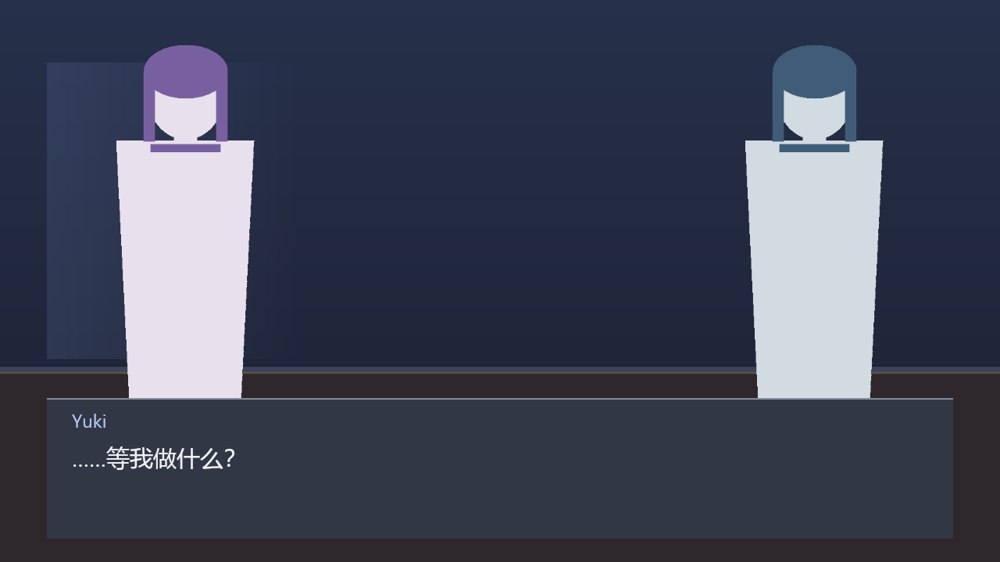

---

## The claim, and how it is tested

The whole design rests on one falsifiable statement:

> Adding a gameplay system does not change the narrative core.

Two systems ship as evidence, chosen to bracket the range of the contract:

- `crates/rustory-vn-gameplay-timer` — a countdown over a list of options.
- `crates/rustory-vn-gameplay-quiz` — several rounds, a growing list of answers, and
  a verdict that only exists at the end.

`rustory-vn-core` mentions neither. It has no notion of timers, options, rounds,
scores or correctness. Each crate parses its own config from an opaque value,
reports outcome keys, and lets the *script* decide where those keys lead. Each
persists its own state into a save through the same trait.

The entire integration is two lines:

```rust
registry.register(Box::new(TimedChoice::new()));
registry.register(Box::new(Quiz::new()));
```

The quiz is the stronger half of the argument. A countdown can almost be rebuilt
from a few shared counters, so a critic could say the contract only accommodates
simple things. A quiz cannot: it needs a cursor and a list, which is why it also
proves that a save can carry state the core has never heard of.

If adding a system ever requires editing `rustory-vn-core`, the contract is wrong
and the contract gets fixed — not the core.

## Status

**Playable vertical slice.** Working today:

- Load a story from RON, with reference checking before the first frame
- Background, sprites and typewriter dialogue
- **Music and sound effects**, with fades; a one-shot is an event, the track is saved
- Click to advance; first click completes the line, second advances
- Branching choices
- Gameplay handover, with **two** systems: a timed choice and a multi-round quiz
- **Save and load**, including gameplay state mid-system (`F5` / `F9` in a window)
- `rustory play` in a window, or `rustory shot` to render a frame headlessly
- 359 tests, including offscreen GPU renders, colour round-trips, and 81 in `rustory-vn-edit`

Not yet: player rollback history, pointer input for gameplay. Those have ADRs describing the
plan, not code pretending to be one.

## Editor

Two front-ends, one operation layer. The GUI and the CLI both construct
`rustory_vn_edit::EditOp` values and hand them to the same executor, so an agent can do
anything a person can — not by keeping two programs in agreement, but because there is
only one program's worth of rules.

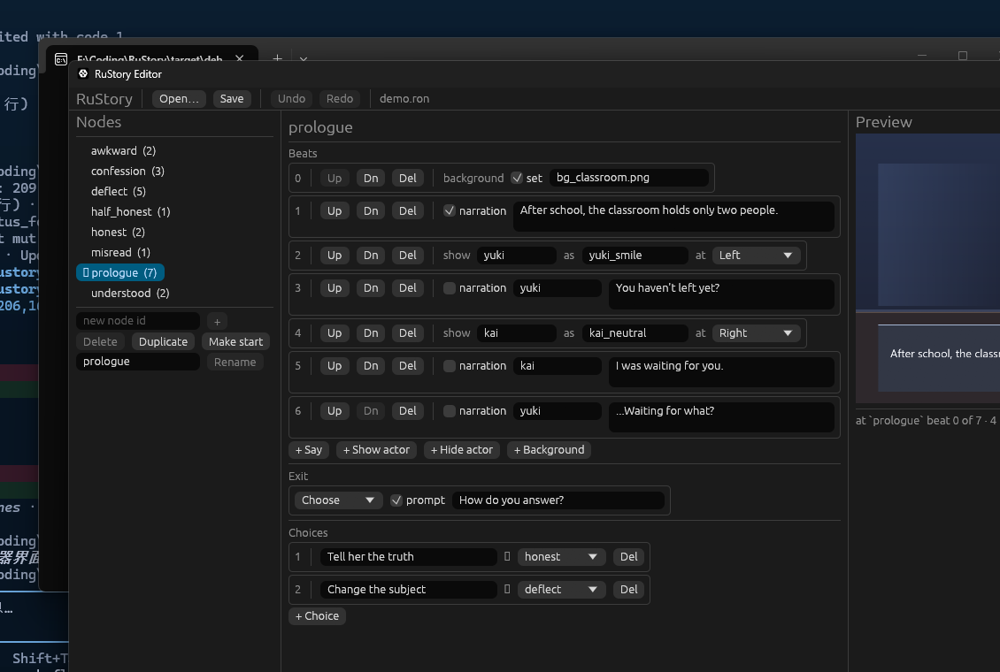

Every shortcut is also on screen: **F1** (or the `?` button) opens the list, because a key
nobody can find is not a shortcut.

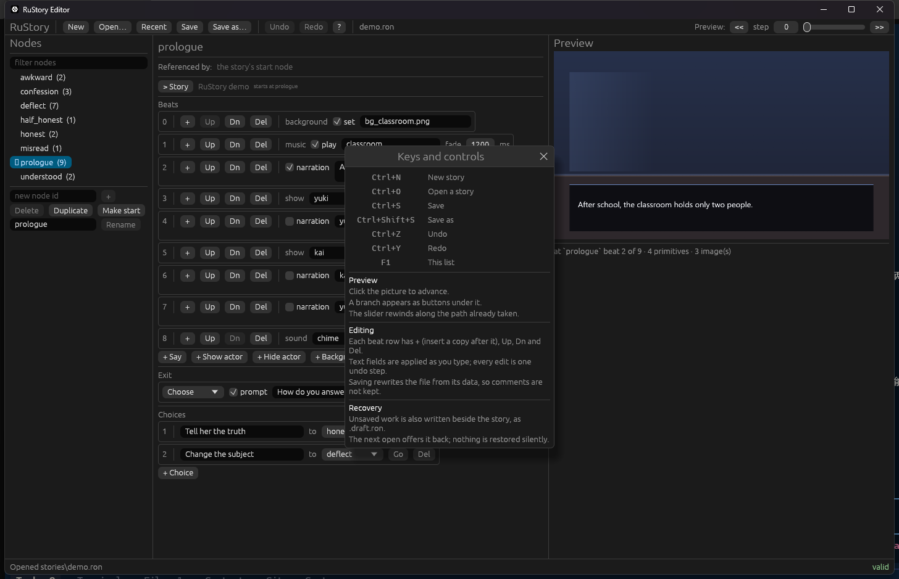

**Ctrl+H** opens the history panel: every state the tab can jump to, labelled with the operation
that produced it. Clicking a row is undo-or-redo repeated, so the panel and the keyboard cannot
disagree about what the document contains, and the file on disk stays untouched until you save.
This is the author's counterpart to a player's save slots — one returns to a place in the
story, the other to a place in the work.

Several stories can be open at once. Each tab carries its own selection, filter, preview path,
undo history and recovery draft; the window keeps the renderer, the status line and the recent
list. A dot after a name means unsaved changes, and closing a dirty tab — or the window — asks
first.

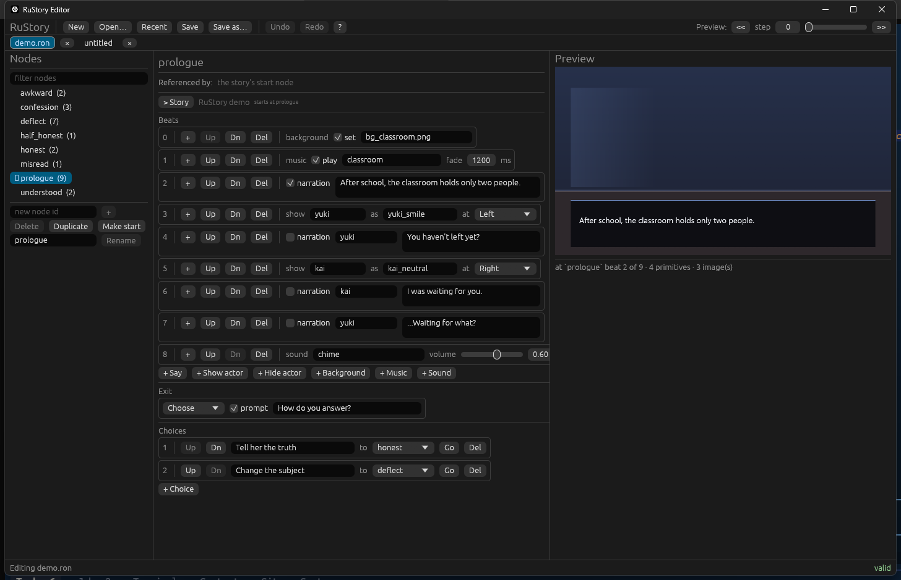

```console
$ cargo run -p rustory-vn-editor                        # new story
$ cargo run -p rustory-vn-editor -- stories/demo.ron    # open an existing one
$ cargo run -p rustory-vn -- ops --json                 # what an agent can do
$ cargo run -p rustory-vn -- inspect stories/demo.ron --json
$ cargo run -p rustory-vn -- edit stories/demo.ron --op '{"op":"CreateNode","id":"epilogue"}'
```

`ops` prints a JSON body for each operation that parses as written — copy one and change
its values, rather than inferring field names from prose. `--json` output is a single
document on stdout; anything else goes to stderr, so a parser can trust it.

The editor is a normal desktop application: **New / Open / Save / Save as** with
`Ctrl+N`, `Ctrl+O`, `Ctrl+S`, `Ctrl+Shift+S`, **Ctrl+W** to close a tab, undo and redo on
`Ctrl+Z` / `Ctrl+Y`, and a prompt before anything throws away unsaved work. **Recent** keeps
the last ten stories one click away, and the same list is readable from a terminal — an agent
can ask what the user has been editing without opening a window:

```console
$ cargo run -p rustory-vn-editor -- --recent          # one path per line
$ cargo run -p rustory-vn-editor -- --recent --json   # same list, structured
```

The list lives in `%APPDATA%\rustory\recent.json` (`$XDG_CONFIG_HOME/rustory` elsewhere)
and is pruned on startup: an entry that no longer opens is dropped rather than offered.

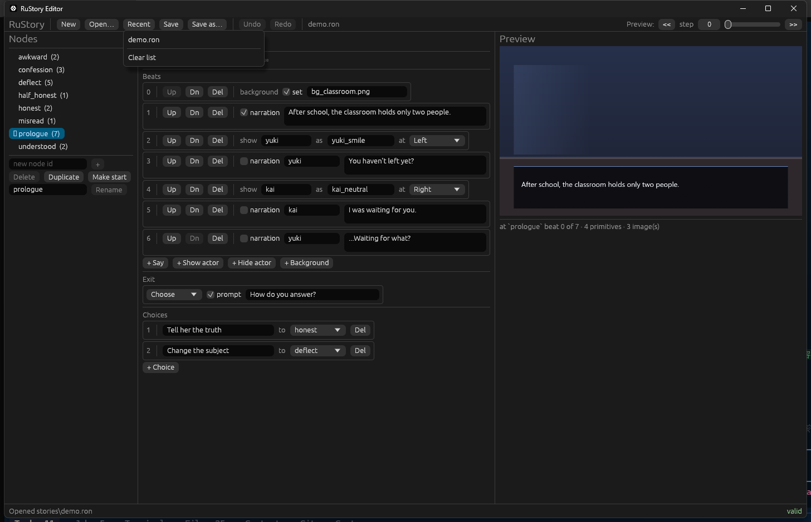

Nodes, beats, exits, choices and gameplay outcome mappings are all editable as forms.
The outcome table is what makes a gameplay system reusable: the same `timer.timed_choice`
can mean different things in different scenes because *where each key leads is data*.

A gameplay node is edited in full, not half: a config box above the table carries the RON the
system receives, pretty-printed, so a duration or a quiz's questions change without leaving
the window. It is checked for being parseable RON and nothing else — the core treats a config
as opaque, and a check that knew the shape would mean the editor had learned every system.

The node list has a filter, and every reference — a `goto`, a choice target, a gameplay
outcome — has a **Go** button beside it, so following a branch never means remembering a
node name and scrolling to find it. The node being edited also lists who points at it —
the same list that would block a delete, computed by the same function — with a click to
jump to each referrer. Selection is UI state, not an edit: it takes no undo step and is
never written to disk.

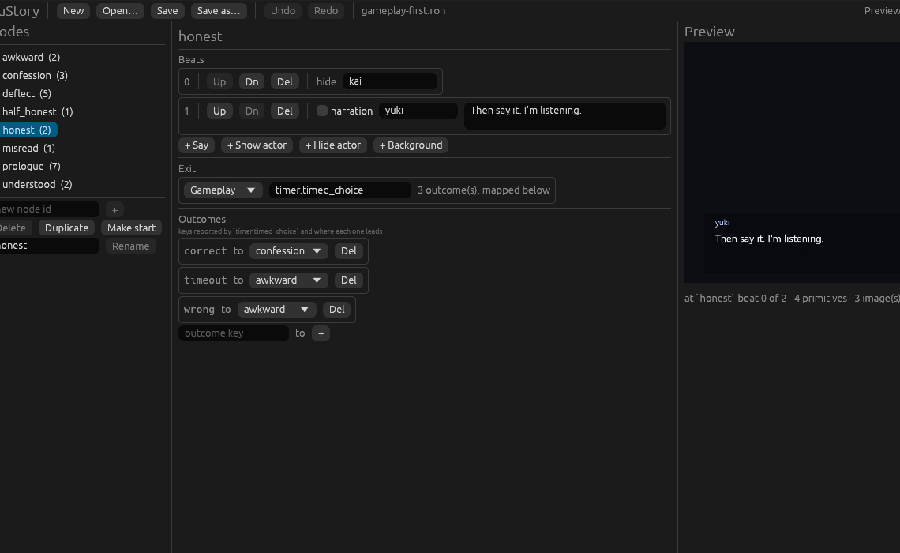

Every edit is **all or nothing**: `Editor::apply` either succeeds and leaves a valid
document, or fails and leaves it byte-for-byte as it was. That is what makes the CLI
safe to point an agent at.

Work that has unsaved changes is also written beside the story as `<story>.draft.ron`,
two seconds after typing stops. A crash costs nothing; the next open offers to recover it.
Nothing is restored automatically, and a draft that will not parse is treated as absent —
a recovery that becomes a puzzle is worse than no recovery.

One honest limit: a story is a data structure, and RON comments are not part of one, so
saving rewrites the file in the editor's formatting and removes any comments it had. The
editor says so once per document, before the first overwrite, rather than letting an author
discover it afterwards.

Failures are machine-readable as well: with `--json`, a refusal answers with a stable `code`
beside the sentence — `node_in_use`, `no_such_node`, `would_invalidate`, `invalid_operation`,
`bad_arguments` — so an agent can branch on the reason instead of parsing prose. The codes
are part of the interface; a test asserts each failure has a distinct one.

Deleting a node that is still referenced is refused, and the error names every
referrer. Deleting the last choice of a branch is refused rather than silently
turning the exit into an `End`.

Content problems that are not errors are reported instead: a node no path can reach, a
gameplay node that maps no outcomes. They are listed in the preview panel and in the
status bar, not refused, because a draft branch is a normal state while writing.

The preview panel is the real engine — `rustory_vn_render` drawing the same `Frame` that
`rustory play` shows — and it starts at the node you have selected, so clicking a node
shows that node's frame rather than the top of the story. It is a playthrough, not a
still: click the picture to advance, and when the story offers branches they appear as
buttons under it. See [ADR 0008](docs/adr/0008-editor-architecture.md).

## Try it

```console
$ cargo run -p rustory-vn -- gen-assets assets       # placeholder art
$ cargo run -p rustory-vn -- check stories/demo.ron  # parse, validate, ask every system to read its config (--json for a report)
$ cargo run -p rustory-vn -- play stories/demo.ron   # play it
$ cargo run -p rustory-vn -- shot stories/demo.ron --out frame.png --advance 4
$ cargo run -p rustory-vn -- shot stories/demo.ron --at honest:2 --out frame.png
$ cargo run -p rustory-vn -- shot stories/demo.ron --at honest:exit --out timer.png  # the gameplay screen

$ cargo run -p rustory-vn -- save stories/demo.ron --advance 6 --out save.ron
$ cargo run -p rustory-vn -- resume stories/demo.ron save.ron --finish
```

`--advance` counts clicks, which is what a player does; `--at` names a position, which
is what a caller who knows what it wants does. They are not the same thing: one click can
finish a revealing line without moving on, and inside a gameplay system a click plays the
whole interaction.

`--at node:exit` is the third form and the one a gameplay author wants: past the node's last
beat, so the frame is the choice or the system's own screen rather than the line before it.
Without it there is no way to screenshot a gameplay screen without a window.

The demo runs without a window too:

```console
$ cargo run -p rustory-vn -- transcript stories/demo.ron
After school, the classroom holds only two people.
Yuki: You haven't left yet?
Kai: I was waiting for you.
...
```

## Screens

| Dialogue | Choice | Timed choice | Quiz |
|---|---|---|---|
|  | 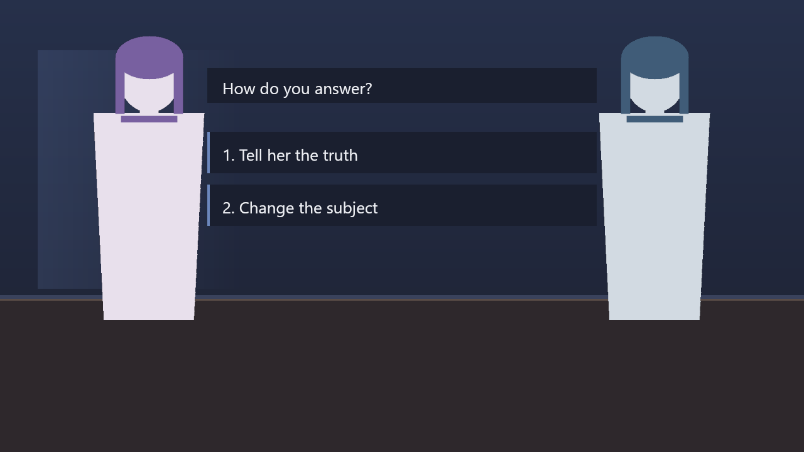 | 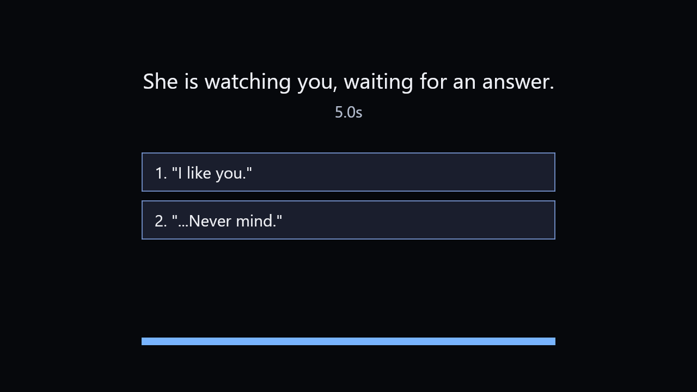 | 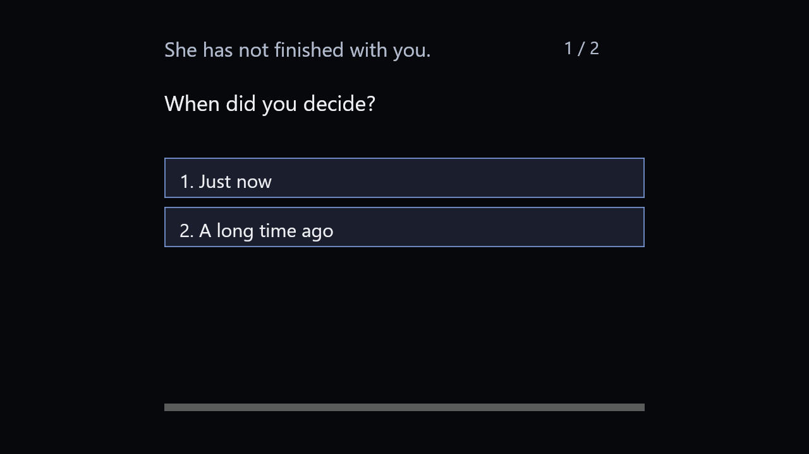 |

The art is generated procedurally by `rustory gen-assets` — no binaries in the
repository, and the code that draws it is reviewable.

## Architecture

The engine is written directly against the platform, without a third-party game
engine underneath. **Game semantics are ours; operating-system abstractions are
borrowed.**

| Layer | Crate | Owns |
|---|---|---|
| Narrative core | `rustory-vn-core` | Story model, state machine, gameplay contract. Zero rendering dependencies |
| Story format | `rustory-vn-script` | RON loading, reference validation |
| Renderer | `rustory-vn-render` | Draw list → pixels on `wgpu`. Knows nothing about stories |
| Gameplay | `rustory-vn-gameplay-timer`, `rustory-vn-gameplay-quiz` | Two systems bracketing the range: a countdown, and state no counter could hold |
| Sandbox | `rustory-vn-gameplay-wasm` | The same contract, reached through a WebAssembly boundary. Runs code the engine did not write |
| Editor | `rustory-vn-edit` | Document, typed operations, undo, validation. No UI, no pixels |
| Application | `apps/rustory-vn`, `apps/rustory-vn-editor` | CLI and player; GUI editor. Both are front-ends over `rustory-vn-edit` |

Dependencies point one way: everything depends on `rustory-vn-core`; the core
depends on nothing above it.

Three boundaries are enforced by types rather than convention:

1. **The core never parses a gameplay config.** A `GameplaySpec` carries an
   opaque `ron::Value`; each system parses its own.
2. **A gameplay system cannot see the stage or the story graph.** It receives
   `GameplayContext { dt_ms, inputs, &mut Stats, &NarrativeSnapshot }` and nothing
   else. The snapshot is a copy, so a system can see which node and beat the story
   is on — and which nodes it has already visited — without gaining a way to move
   the story itself.
3. **The renderer cannot see game concepts.** It consumes a `Frame` — quads and
   text runs — so layout is testable without a GPU.

Read [`docs/architecture.md`](docs/architecture.md) for the full picture and
[`docs/adr/`](docs/adr/) for why each decision went the way it did.

## Building

Requires Rust 1.87+ (edition 2024; the audio decoder needs 1.87) and, on Windows, the MSVC toolchain.

```console
cargo check --workspace     # fastest feedback
cargo build                 # first run pulls the wgpu tree; minutes
cargo test --workspace      # 359 tests; render tests skip without a GPU
cargo run -p rustory-vn -- probe
```

The dev profile builds dependencies at `opt-level = 3` — an unoptimized
`wgpu`/`naga` build is slow enough that a frame-rate problem looks like a
renderer bug — while workspace crates stay at `opt-level = 1`.

## Fonts

The engine ships **no typefaces**. A typeface is a design decision and a licensing
question that belong to the project, not to the engine: a CJK face alone is 10MB+,
and many commercial ones cannot be redistributed at all.

Which means a project that cares about its typography supplies its own:

```console
$ mkdir -p assets/fonts && cp MyTypeface.ttf assets/fonts/
$ cargo run -p rustory-vn -- shot stories/demo.ron --out frame.png
font: My Typeface
```

Dropping a file in `assets/fonts/` is enough — the first family found becomes the
default. `--font "Family Name"` selects a specific one, and the loader reports the
family a file *declares* rather than its filename, because `AGENCYR.TTF` being
`Agency FB` is not something a creator should have to guess.

A project with no fonts renders in the platform's default sans-serif, which is a
reasonable place to start. See [ADR 0007](docs/adr/0007-fonts-are-the-projects-choice.md).

## Sound

Like fonts, audio files belong to the project. A track name in a story is a file stem in
`assets/audio/` (`ogg`, `wav`, `flac` or `mp3`), and the engine has no opinion past that.

```ron
Music(track: Some("classroom"), fade_ms: Some(1200)),
Sound(clip: "door", volume: Some(0.6)),
```

Two beats, and the difference between them is the interesting part:

- **Music is state.** It is still playing when nothing is happening, so it goes into the
  save file and a resumed scene brings its track back.
- **A one-shot is an event.** It happened and stopped. Saving it would mean replaying a door
  slam every time the player loads a save inside that scene.

`fade_ms` is direction, not host policy: changing track fades the old one out and the new
one in, and `0` cuts. With no audio device the game runs silent and says so once — a missing
sound card is a degraded game, not a broken one. See
[ADR 0009](docs/adr/0009-audio-as-beats.md).

The demo's sounds are generated by `rustory gen-assets`, the same command as the placeholder
art, so a fresh clone is audible without carrying a single binary in the repository.

## Translations

A line is written out, or named by a key the story resolves. Both forms are one field, so a
single-language project pays nothing and a translated one needs no second graph:

```ron
Say(speaker: None, text: "The last train has gone."),          // as written
Say(speaker: None, text: (key: "platform.narration")),         // translated
```

```ron
locales: {
    "en": { "platform.narration": "The last train has gone." },
    "ja": { "platform.narration": "最終電車は行ってしまった。" },
    "zh-Hans": { "platform.narration": "末班车已经走了。" },
},
default_language: Some("en"),
```

The same story, three languages — nodes and branches exist once:

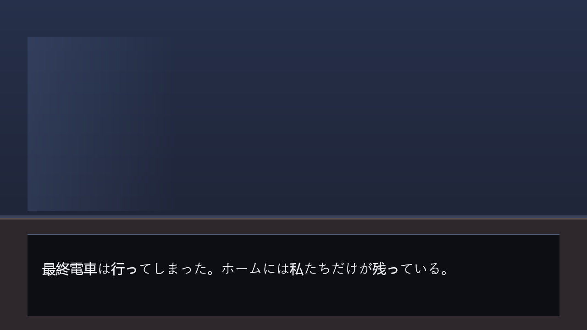
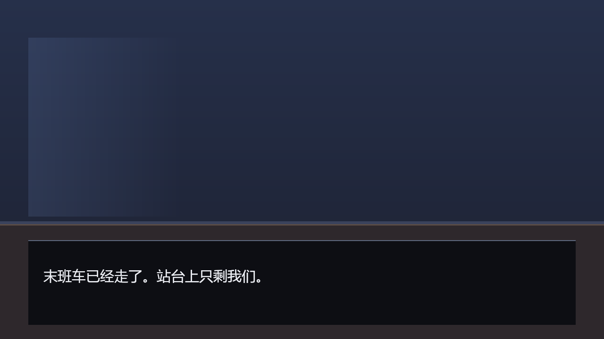

```console
$ cargo run -p rustory-vn -- transcript stories/localised.ron --language ja
$ cargo run -p rustory-vn -- play stories/localised.ron --language zh-Hans
$ cargo run -p rustory-vn -- check stories/localised.ron        # per-language completeness
```

Keys are resolved once, at load, so the renderer, the save format and the state machine never
see a key. A missing translation is a load error naming the key and the language, not a blank
box three scenes in — and because a save records a node and a beat index rather than any text, a
save made in English resumes in Japanese at the same line. See
[ADR 0011](docs/adr/0011-localisation.md).

Strict is the right default and the wrong rule for the person writing the file. `--allow-missing`
plays with the default language's line where a translation is missing, and shows the key itself
when there is no default — never a blank, because a hole must not look like prose:

```console
$ cargo run -p rustory-vn -- transcript stories/localised.ron --language ja --allow-missing
```

`check` stays strict, so the holes are still counted; the flag only changes what playback does.

## Writing a story

```ron
Story(
    start: "prologue",
    nodes: {
        "prologue": (
            beats: [
                SetBackground(image: Some("bg_classroom.png")),
                Say(speaker: None, text: "The bell rings."),
                ShowActor(actor: "yuki", pose: "yuki_smile", slot: Left),
                Say(speaker: Some("yuki"), text: "You are still here?"),
            ],
            exit: Choose(
                prompt: Some("How do you answer?"),
                choices: [
                    (label: "Honestly", to: "honest"),
                    (label: "Change the subject", to: "deflect"),
                ],
            ),
        ),
    },
)
```

See [`stories/demo.ron`](stories/demo.ron) for a complete example, including a
gameplay handover. Story text can be any language: CJK shaping and line breaking
are exercised by a dedicated renderer test that pushes a Chinese paragraph through
the same code path.

## Adding gameplay

See [`docs/gameplay-integration.md`](docs/gameplay-integration.md). Short
version: new crate, implement `GameplaySystem`, register one line, reference it
from a script.

A system is not blind to the story it interrupts. `begin` and `step` both receive a
`NarrativeSnapshot` — the node, the beat position, every node visited and every
choice made, all owned and read-only. That is enough for a system whose content
depends on history (a fight that is harder the second time, a quiz that only asks
about a scene already read) without letting it rewrite the story. See
[ADR 0012](docs/adr/0012-gameplay-sees-the-story.md) for why it is a copy and not
`&Narrative`.

A system also draws its own screen. `view` returns a `GameplayView`: text, panels, images and
bars in the engine's 1280×720 design box, coloured by role rather than by value, so the project
keeps its palette and a system stays portable. `rustory shot <story> --at <node>:exit` renders
one without a window — see the last two screenshots above and
[ADR 0013](docs/adr/0013-gameplay-draws-itself.md).

A system does not have to be Rust compiled into the binary. `rustory-vn-gameplay-wasm` runs a
WebAssembly module through the same trait — with no imports at all, so a guest cannot open a
file or read the clock, and a per-call instruction budget, so it cannot hang the window.

A story names its modules and the environment supplies them, in this order: `--plugin
name=path`, then the story's own `plugins` map, then `plugins/<name>.wasm` beside the story or
one level up. The first two exist for the cases that need them; the third is why a cloned
repository plays with no flags at all:

```console
$ cargo run -p rustory-vn -- check stories/doors.ron
ok: stories/doors.ron
plugin doors: plugins\doors.wasm (directory)

$ cargo run -p rustory-vn -- play stories/doors.ron
$ cargo run -p rustory-vn -- play stories/doors.ron --plugin doors=build/debug/doors.wasm
```

`examples/wasm-guest` is a working module — 1.6 KB of `no_std` Rust implementing the documented
ABI by hand, which is also how the instruction budget was measured rather than guessed. See
[ADR 0017](docs/adr/0017-wasm-plugins.md) and [ADR 0015](docs/adr/0015-wasm-tier.md).

## Contributing

See [`docs/contributing.md`](docs/contributing.md): the build and test commands, the four
rules that are not negotiable, the commit convention, and how to add a gameplay or change
an architectural decision.

Commits follow Conventional Commits in English, one logical change per commit. What changed for
a user goes in [`CHANGELOG.md`](CHANGELOG.md) under `[Unreleased]`.

## License

MIT OR Apache-2.0, at your option. See [`LICENSE-MIT`](LICENSE-MIT) and
[`LICENSE-APACHE`](LICENSE-APACHE).

This project is not affiliated with or endorsed by the Rust Foundation. "Rust" is used
only to say what the engine is written in.
